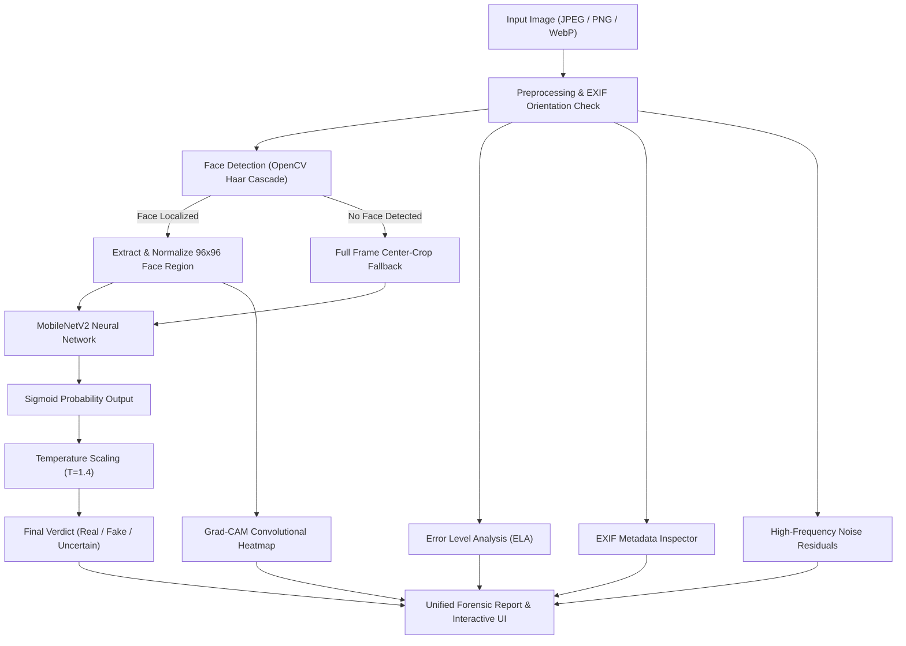

# 🛡️ AI Image Authenticity Analyzer

<p align="center">
  
  
  
  
  
  
</p>

<p align="center">
  <b>A comprehensive deep learning and computer vision forensics toolkit designed to analyze, detect, and explain manipulated and synthetic facial imagery.</b>
</p>

---

## 📖 Executive Summary

The **AI Image Authenticity Analyzer** is an end-to-end digital forensics platform engineered to determine whether facial portraits are authentic human photographs or synthetically synthesized by generative AI models (such as StyleGAN and deepfake pipelines). 

Unlike black-box classifiers that return an isolated prediction score, this platform couples a high-accuracy neural backbone with a multi-layered computer vision forensics suite—providing visual interpretability (Grad-CAM heatmaps), compression analysis (Error Level Analysis), noise variance maps, luminance gradients, and metadata verification.

The project includes:
- 🖥️ **Interactive Web Application**: A modern, high-contrast, multi-theme Streamlit dashboard.
- ⚡ **Asynchronous REST API**: A production-ready FastAPI service with job queuing and rate limiting.
- 💻 **CLI Diagnostic Tool**: Rapid command-line batch verification with human-readable and JSON output formats.
- 🧪 **Pre-trained Deep Neural Network**: Fully packaged and calibrated MobileNetV2 architecture ready for offline inference.

---

## 🌟 Core Capabilities

| Capability | Technical Approach | Diagnostic Output |
| :--- | :--- | :--- |
| **Deepfake Classification** | Fine-tuned MobileNetV2 with temperature calibration | Real / Fake verdict with confidence probability |
| **Visual Explainability** | Gradient-weighted Class Activation Mapping (Grad-CAM) | Spatial heatmap identifying pixel regions driving the decision |
| **Error Level Analysis (ELA)** | Differential multi-pass JPEG recompression analysis | Heatmap highlighting localized compression inconsistencies |
| **Noise Residual Profiling** | Median filtering & high-frequency residual subtraction | Sensor noise pattern consistency across facial boundaries |
| **Luminance Gradient Mapping** | Directional Sobel intensity gradient computation | Physical lighting and shadow alignment analysis |
| **Metadata Audit** | Exchangeable Image File Format (EXIF) header parsing | Camera hardware verification & generative software signatures |

---

## 📊 Benchmarks & Empirical Performance

The bundled model (`deepfake_detection_model.h5`) was evaluated on a strictly balanced, held-out validation and testing corpus of **20,000 images** (FFHQ genuine portraits vs. StyleGAN generative samples):

```
+-------------------------------------------------------+
|  Metric                                   Score       |
+-------------------------------------------------------+
|  Overall Test Accuracy                    93.4%       |
|  Area Under ROC Curve (ROC AUC)           0.9833      |
|  Precision (Weighted Average)             93.4%       |
|  Recall (Weighted Average)                93.4%       |
|  F1-Score                                 93.4%       |
|  Authentic (Real) Accuracy                92.1%       |
|  Manipulated (Fake) Accuracy              94.7%       |
|  Calibration Temperature                  T = 1.40    |
+-------------------------------------------------------+
```

*Evaluation data and confusion matrices are cached in `metrics_cache.json` and plotted directly within the analytics section of the web dashboard.*

---

## 🔬 Forensic Pipeline Architecture

The end-to-end processing pipeline ensures that images uploaded across the web dashboard, REST API, and CLI follow identical preprocessing contracts:



---

## 🚀 Quick Start Guide

### Prerequisites
- **Operating System:** Windows, macOS, or Linux
- **Python Version:** `3.11.x` *(Recommended for TensorFlow 2.16 compatibility)*
- **C++ Runtime:** [Microsoft Visual C++ Redistributable](https://aka.ms/vs/17/release/vc_redist.x64.exe) (Windows users)

### 1. Clone the Repository
```bash
git clone https://github.com/singhpriyanshu010806/AI-Image-Authenticity-Analyzer.git
cd AI-Image-Authenticity-Analyzer
```

### 2. Set Up Virtual Environment & Dependencies
```bash
# Create Python 3.11 environment
python -m venv .venv

# Activate the virtual environment
# Windows (PowerShell):
.\.venv\Scripts\Activate.ps1
# Windows (cmd.exe):
.\.venv\Scripts\activate.bat
# Linux / macOS:
source .venv/bin/activate

# Install dependencies
pip install -r requirements.txt
```

### 3. Launch the Application

#### Option A: One-Click Launchers (Windows)
- Double-click **`run_app.bat`** to start the Streamlit Web Dashboard.
- Double-click **`run_api.bat`** to start the FastAPI service.

#### Option B: Manual Command Line
```bash
# Launch Streamlit Dashboard
streamlit run app.py
# → Access via browser: http://localhost:8501

# Launch REST API Server
uvicorn api.main:app --port 8000 --reload
# → Interactive Swagger Docs: http://localhost:8000/docs
```

---

## 🎨 Interactive Web Dashboard

The web interface is built with Streamlit and includes:

1. **Batch Analysis Mode:** Upload multiple images simultaneously. Each photo receives an individual authenticity score, face bounding box, Grad-CAM visualization, ELA view, and metadata summary.
2. **Side-by-Side Forensic Comparison:** Compare two suspect images concurrently with direct metadata and filter diffing.
3. **Adaptive Visual Themes:** Customize the dashboard palette in the sidebar:
   - 🌈 **Vibrant Prism (Default):** High-contrast, bright, luminous modern interface.
   - 🌅 **Sunset Glow:** Warm vibrant coral, peach, and amber tones.
   - 🌊 **Ocean Breeze:** Electric cyan, azure, and emerald hues.
   - ⚡ **Electric Neon:** Vivid cyberpunk-inspired dark theme with bright glowing accents.
4. **Historical Log & Export:** Automatically tracks past predictions in a local SQLite database with CSV export functionality.
5. **Model Analytics:** Embedded interactive Plotly graphs showcasing the confusion matrix, ROC curve, and dataset distribution.

---

## 📡 REST API Reference

The FastAPI service provides high-throughput programmatic endpoints with automated rate limiting and async queuing.

### Key Endpoints

| Method | Endpoint | Description |
| :--- | :--- | :--- |
| `POST` | `/api/detect` | Synchronous classification with direct verdict and confidence |
| `POST` | `/api/detect/async` | Asynchronous task queueing; returns `202 Accepted` with a `task_id` |
| `GET` | `/api/task/{task_id}` | Poll the execution status (`pending`, `running`, `completed`, `failed`) |
| `GET` | `/api/health` | Service health status, active memory task counts, and model version |

### Example Request (`curl`)
```bash
curl -X POST "http://localhost:8000/api/detect" \
     -H "accept: application/json" \
     -H "Content-Type: multipart/form-data" \
     -F "file=@suspect_portrait.jpg"
```

### Example Response
```json
{
  "verdict": "Fake",
  "confidence": 0.968,
  "is_uncertain": false,
  "confidence_threshold": 0.70,
  "raw_scores": [0.032],
  "face_detected": true,
  "face_box": [120, 94, 210, 210]
}
```

---

## 💻 CLI Diagnostics

Quickly evaluate images from your terminal:

```bash
# Analyze one or more images
python predict.py photo1.jpg photo2.png

# Generate machine-readable JSON output
python predict.py suspect.jpg --json

# Override calibration parameters
python predict.py suspect.jpg --temperature 1.2 --threshold 0.75
```

---

## ⚙️ Configuration & Environment Variables

All settings can be configured via environment variables or a `.env` file:

| Variable | Default | Purpose |
| :--- | :--- | :--- |
| `AI-Image-Authenticity-Analyzer_MODEL_PATH` | `deepfake_detection_model.h5` | Path to the trained Keras H5 model |
| `AI-Image-Authenticity-Analyzer_API_KEY` | *(None)* | Optional API key required in the `X-API-Key` header |
| `AI-Image-Authenticity-Analyzer_RATE_LIMIT` | `10/minute` | Rate limit per client IP on inference endpoints |
| `AI-Image-Authenticity-Analyzer_POLL_RATE_LIMIT` | `120/minute` | Rate limit on task polling endpoints |
| `AI-Image-Authenticity-Analyzer_MAX_ACTIVE_TASKS`| `32` | Maximum concurrent background tasks in memory |
| `AI-Image-Authenticity-Analyzer_PERSIST_HISTORY` | `1` | `1` to persist predictions to SQLite; `0` for session-only |
| `AI-Image-Authenticity-Analyzer_CORS_ORIGINS` | `http://localhost:8501,http://localhost:8000` | Allowed origins for web clients |

---

## 🗂️ Project Organization

```
AI-Image-Authenticity-Analyzer/
├── app.py                      # Main Streamlit web application & theme engine
├── config.py                   # Central parameters, thresholds & input contracts
├── predict.py                  # Shared inference pipeline & CLI interface
├── preprocessing.py            # Image decoding, face crop & color transforms
├── calibration.py              # Temperature scaling for confidence calibration
├── gradcam.py                  # Grad-CAM explainability heatmaps
├── ela_analysis.py             # Error Level Analysis (ELA) implementation
├── exif_analysis.py            # EXIF metadata parser & AI software signature check
├── forensic_filters.py         # Luminance gradients & noise residual filters
├── history.py                  # SQLite database persistence layer
├── metrics.py                  # Evaluation visualizer & Plotly analytics
├── deepfake_detection_model.h5 # Bundled fine-tuned MobileNetV2 neural network
├── deepfake_detection_model.json # Model metadata and training parameters
├── metrics_cache.json          # Cached evaluation metrics on 20,000 test images
├── run_app.bat                 # One-click Windows dashboard runner
├── run_api.bat                 # One-click Windows REST API runner
├── api/
│   ├── main.py                 # FastAPI application endpoints
│   └── task_store.py           # In-memory async background task coordinator
├── experiments/                # Training routines and loss curves
├── scripts/                    # Dataset download and verification helpers
└── tests/                      # Automated pytest unit and integration test suite
```

---

## 🛡️ Responsible AI & Ethical Use

This software is provided for research, media verification, and educational purposes to combat malicious impersonation, fraud, and misinformation. Users should be aware that no AI detection model is 100% infallible:
- Results should be corroborated using the provided visual forensics (ELA, noise maps, EXIF metadata).
- Re-compression or aggressive filters applied by social media platforms can degrade image fidelity and impact confidence.

---

## 📜 License & Credits

Distributed under the **MIT License**. See [`LICENSE`](LICENSE) for details.

Developed & Maintained by **[Priyanshu Singh](https://github.com/singhpriyanshu010806)**.
Contributions, bug reports, and feature suggestions are welcome!
